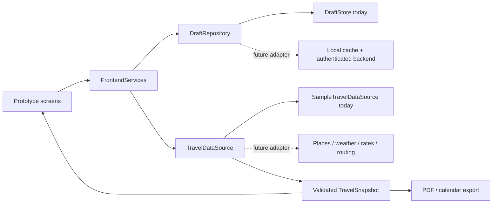

# Connecting APIs and a backend after the prototype

The active frontend now depends on interfaces, not on a particular database or travel vendor. It still runs entirely in local/sample mode by default. No live API keys, account authentication, calendar publishing, photo uploads or shared-trip server have been enabled by this refactor.

## One place to choose adapters

`TripFitApp.onCreate()` constructs `FrontendServices` with:

- `DraftRepository` → `DraftStore`, the existing local JSON draft cache.
- `TravelDataSource` → `SampleTravelDataSource`, the current sample travel catalog, forecasts, rates and routing estimates.

`PrototypeActivity` obtains that shared instance for the active trip screens. Future implementations can replace those two bindings. The existing XML/Room screens retain their `TripRepository`/ViewModel architecture; they have not been deleted or silently migrated. Choose a single canonical persistence model when consolidating those older screens with the active prototype.

## Travel APIs

Implement `TravelDataSource` and bind it in the application factory. Vendor DTOs, HTTP clients, credentials and retry policy belong in that adapter, not in an Activity.

1. `cached(TravelQuery)` returns an already available snapshot. It must never make HTTP calls or block waiting for them. Supply a usable cached/bootstrap city catalog, rate table and the current trip's city metadata before enabling a live adapter.
2. `refresh(TravelQuery, Callback<TravelSnapshot>)` loads data asynchronously. Its callback uses the existing `Result` envelope. Keep the previous cache on timeout, authentication failure or malformed data.
3. Validate the complete snapshot for the requested trip and currencies before replacing the cache. `TravelSnapshot.validateFor`, the model constructors, and `ExchangeRates` help reject incomplete/invalid responses. A price tier alone is not an exact cost: use a null `PlaceSuggestion.price` when an estimate is unavailable. Those stops remain explicitly unpriced and are excluded from budget-filtered suggestions.
4. Preserve request identity. `TravelQuery` is immutable; screens discard outdated callbacks after edits, a newer refresh, or Activity destruction. An adapter should likewise avoid overwriting a newer cache with an older response.
5. Report actual provenance using `placeSource`, `routeSource`, `ExchangeRates.description`/`fetchedAtMillis`, and `DailyForecast.source`/`sample`. Sample forecast controls are shown only for sample forecasts.

`TravelQuery` contains the destination, dates, relevant currencies and route-point metadata. It excludes journal notes, photos, member names, votes and expense amounts. Each vendor should receive only the fields required for its request, not a serialized copy of the entire trip.

| Proposal service | Adapter output |
| --- | --- |
| Foursquare / cached Supabase places | `Destination` and `PlaceSuggestion`, including opaque vendor IDs, coordinates, original currency, nullable price estimate, price tier, rating/reviews and suggested duration. Existing `SupabaseApi`/DTOs can be reused behind a mapper. |
| Wikivoyage/community discovery | Curated `PlaceSuggestion` items; preserve source attribution and do not infer that sparse or missing ratings prove a place is a hidden gem. |
| Frankfurter/currency provider | `ExchangeRates`, normalized so every entry expresses one unit in a common base currency. Unsupported currencies produce an error, rather than silently using PHP. Verify conversion direction with a known currency pair. |
| OpenWeather | `DailyForecast` entries indexed by the trip day using its start date and destination time zone. Missing forecasts remain unavailable, not implicitly clear. Ignore sample weather overrides in a live adapter. |
| OpenRouteService matrix/directions | A cached `TravelTimeProvider` for driving/walking/cycling. Populate the relevant mode/coordinate pairs before returning the snapshot. |
| Google transit routing | Transit leg estimates in the same `TravelTimeProvider`; include the appropriate departure/date context from the request. |

`RoutePreview.day(..., TravelTimeProvider)` owns scheduling around booked blocks. It uses the supplied travel times and buffers, and applies an optimized preview only when the estimate does not get longer or add conflicts. A provider's `minutes` and `mode` methods are synchronous cache reads: never put a network request inside them. Freeze a coherent matrix version for each snapshot; if using an estimated fallback, label it in `routeSource`.

The active budget, discovery, itinerary and summary screens use the injected rates/times. `TripExport` has snapshot-taking overloads so PDF and calendar output use the same data as the UI. Its convenience overloads without a snapshot remain sample-only helpers for tests and local examples.

## Trip backend

Implement `DraftRepository` using the chosen local database plus an authenticated sync layer:

- `all/get/save` remain local-cache operations. Do not replace them with blocking REST calls on the UI thread.
- Save local edits first. If cloud writes are enabled later, use a durable outbox/retry mechanism and expose sync/error state. A successful local save does not prove a cloud write succeeded.
- `refresh` is the asynchronous read/update boundary. Preserve unsynced edits and report errors without replacing local drafts with an empty list.
- Keep trip/stop/expense/journal UUIDs stable. Preserve `Stop.placeId` and `destinationId` separately from display names. Keep original currencies and coordinates. Do not use a renamed place's label as its database identity.
- Scope caches, authorization and row access to the signed-in account. Map API DTOs into the domain model and validate destination currency/time zone. Authentication and server authorization are still required work.
- Plan an explicit migration from existing local drafts/Room rows. New fields are additive, and a compatibility test covers older saved JSON. Do not upload seeded `sample` trips automatically or discard existing drafts during account setup.

The current `DraftStore` preference name is unchanged (`trippings_prototype_v1`). Existing prototype drafts continue to open. There is no automatic cloud sync in this change.

## Features requiring separate authenticated write flows

Read-data refresh must not publish calendar events, invite people, upload images or make payments.

- **Google Calendar:** the current screen previews events and exports a real `.ics` file. Add OAuth, explicit sync consent, event-ID mapping, idempotent updates, error/retry handling and a real server-confirmed receipt before changing that preview to live publishing. The `calendarPreview` flag is not a sync receipt.
- **Groups:** current members, join codes and votes are local demonstrations. Real rooms require server-issued room IDs/codes, authenticated member IDs, authorization and per-user votes. Sample display names are not trusted account identities. Voting now records stable place IDs while retaining compatibility with older sample-name votes.
- **Journal photos:** a selected Android content URI is local device access, not a remote image URL. An authenticated uploader should read only selected images through `ContentResolver` and return a remote asset ID. Keep local access and upload state distinct, and do not upload merely because travel data was refreshed.

Keep privileged service keys on the backend. Existing local configuration should stay ignored by Git. Bind sample adapters until the chosen live adapters, account configuration, permissions and vendor contracts have actually been implemented and checked.

## Checks

- Unit checks cover injected cities/rates/travel times, malformed data, unsupported currencies, immutable requests that exclude private content, old-draft compatibility, daily and overall budget limits, non-regressing route previews and booked/journal rules.
- Device workflows exercise the actual trip settings, destination form, mixed discovery plan, food/activity budget filters, expenses, booking-preserving route/day changes, weather swaps, group joins/votes, journal draft recreation/local photos, calendar preview, and replacement travel adapters including refresh failure.
- `PrototypeDeviceTest` covers map taps/results, persisted pins/expenses, renderable PDF output, all toolkit screens and their system-bar spacing.

Run `testDebugUnitTest`, `assembleDebug`, `assembleDebugAndroidTest` and `lintDebug`. Use an emulator for device checks. The workflow tests install an isolated repository binding and restore it afterward; they do not use the user's saved trips or live API accounts. Android's connected-test task may reinstall the application, so use a dedicated test emulator when running that task.
